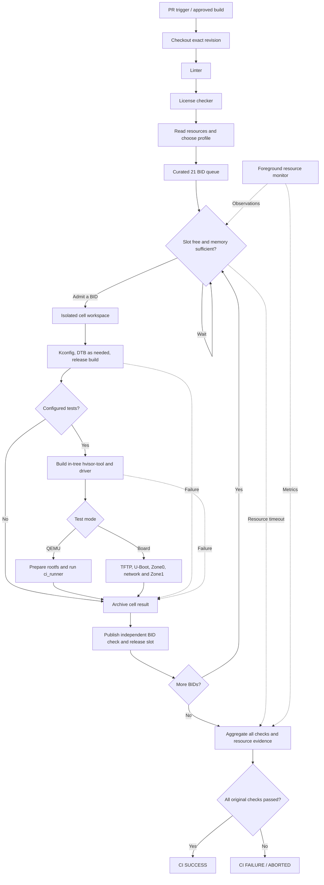

# CI resource governance

The PR pipeline still checks all curated BIDs in `matrixBids()` in the Jenkinsfile.
The linter, license checker, platform configuration, in-tree hvisor-tool build,
test cases in `ci.yaml`, GitHub Check names and per-cell logs are unchanged.
The matrix is no longer an unrestricted fan-out: a small number of Jenkins
workers take BIDs from a workspace-local rolling queue (standard Python,
Linux file locks and existing Pipeline steps; no new Jenkins plugin).
A slot is held through preparation, compilation, tests and archiving because
QEMU's `make ci-run` can also invoke compilation.



## First rollout and tuning

`resource_policy.json` deliberately starts with an **unvalidated** pilot:
two active cells, two Cargo jobs per cell, and serial Make / Kbuild
(`MAKEFLAGS=-j1`). This is a calibration starting point, not a proven safe
capacity. Ordinary PRs run the whole matrix automatically.

* Start the initial pilot on the current single-executor CI node with at
  least 11 GiB effective available RAM. Linux `MemAvailable` is further
  bounded by any readable finite cgroup-v2 ancestor memory limit.
* Admission pauses below 4 GiB and resumes at 5 GiB. The sampler records
  pressure even while all slots are occupied. Startup and dispatch resource
  waits are bounded to five minutes. If memory does not recover,
  or the monitor detects a new cgroup OOM kill or changed Jenkins service
  identity, stop new dispatch; incomplete BIDs are not marked successful.
  Work already admitted can finish its normal test cleanup.
* The 3 GiB reserve is a tuning target, not an operating-system-enforced
  memory limit. Existing Swap is observed, not enlarged as part of CI.
* Once the first full run is safe, trial 3 cells x 2 jobs, then 4 x 2 only
  if the previous samples leave sufficient margin. If CPU remains idle
  and memory permits, trial 3 jobs at the already-safe cell count.
  If 2 x 2 proves unsafe, use 1 x 1 as the next explicit calibration trial.
  Change one dimension at a time in the isolated CI revision (keep
  `validated_profiles` empty for an explicit pilot trial); never automatically
  promote a pilot during a normal build.
* For each candidate record total build duration, minimum effective available
  memory (at least 3 GiB targeted), swap activity, service identity/restarts,
  kernel OOM evidence, and all 21 platform results. The four QEMU paths and
  Phytium-Pi board cases must pass along with linter and license checker.
  Confirm the final profile with two complete successful builds.
* Enter only measured, reviewed profiles into `validated_profiles`, for example:

  ```json
  {
    "name": "example-only",
    "slots": 2,
    "cargo_jobs": 2,
    "min_start_available_mib": 11000,
    "duration_seconds": 600,
    "successful_runs": 2
  }
  ```

  The numbers above are illustrative, **not measurement results**. Use the larger
  of the measured suggested startup thresholds from the two runs. The resource
  summary suggests reserve + 125% of the worst observed drop from preflight
  available memory (with the resume threshold as a floor). The scheduler
  selects the fastest eligible validated profile, or a validated smaller
  fallback if memory is insufficient. Once validated profiles exist, it never
  falls back to an unvalidated pilot on its own.

The bound is per top-level Pipeline run. The current CI host has one
executor; keep the existing cross-build admission policy. If multiple
top-level builds or independent agents share that host in the future,
review a host-wide resource gate or dedicated build-agent isolation first.
The dispatcher cannot guarantee that arbitrary external memory spikes
or single-process allocation bursts will never cause host OOM.

## Build evidence

The matrix stage archives `.jenkins/ci-resources/<build-number>/` before
workspace cleanup:

* `bids.json`: complete canonical inventory.
* `state.json` and `results.json`: selected profile, pending/active state,
  per-BID results, duration and observed maximum active cells.
* `metrics.jsonl`: five-second observations of host memory, effective
  cgroup headroom, swap, CPU, memory pressure (PSI, when available),
  cgroup memory/OOM events and Jenkins service identity (when readable).
* `resource-summary.json`: low water mark, observed peak demand, suggested
  startup threshold, and any observed resource incident.

A controller killed by OOM may not be able to archive its own workspace.
For calibration builds obtain an independent, read-only host observation and
the administrator's kernel/systemd journal for the build interval. Missing
optional cgroup or service fields are not proof of the absence of host OOM.
The suspected OOM in PR #452 build #2 remains unconfirmed until Linux logs
are available; existing PR #451 OOM evidence is separate.

The existing `sync_bid_matrix.py` also understands the new explicit
`matrixBids()` list, but directory discovery is not equivalent to curated
coverage (notably the Asterinas BID alias and excluded physical platforms).
Do not replace the current list with auto-discovered directories as part of
resource tuning.

## Local regression tests (no CI server or board required)

```bash
PYTHONDONTWRITEBYTECODE=1 PYTHONPATH=jenkins python3 -m unittest discover -s jenkins/tests -v
```

These tests exercise real lock contention, rolling refill, all 21 BIDs,
check inventory, memory hysteresis and timeout, failure/abort, resource
observation and reviewed profile selection. The CLI lifecycle test feeds a
fixed Linux memory sample on any host that supports `flock`. Board and QEMU
verification still runs on the Jenkins node.
